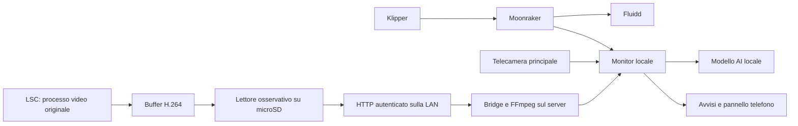

# Architettura e prerequisiti

Il monitor è un servizio separato dalla stampante. Legge lo stato via Moonraker e acquisisce immagini. Fluidd è un’altra interfaccia dello stesso Moonraker: per ottenere dati coerenti si legge Moonraker, non il testo HTML mostrato da Fluidd.

## Requisiti del server

- Un computer destinato a restare acceso e a raggiungere la stampante e le telecamere.
- La versione Python richiesta dalla release; nel percorso provato è stato usato Python 3.12 su macOS Apple Silicon.
- FFmpeg per decodificare il trasporto LSC/H.264 o estrarre immagini da una sorgente RTSP.
- Un ambiente Python isolato e le dipendenze indicate dal repository.
- Un modello AI compatibile con l’implementazione, ottenuto con diritti di utilizzo adeguati.
- Per il telefono: un accesso privato autenticato e, per Web Push, un contesto HTTPS e un browser compatibile.

L’installazione su un computer non prova il funzionamento su ogni sistema operativo o architettura. La disponibilità di un pacchetto o di un’app non dimostra che il server, il modello e la telecamera siano già configurati.

## Requisiti della telecamera LSC

La marca commerciale non identifica il firmware. Il percorso studiato riguarda una famiglia Anyka con ARM926EJ-S / ARMv5TEJ, Linux e risorse limitate. Altri modelli con lo stesso marchio possono essere incompatibili.

Serve un bootstrap microSD già conosciuto e verificato per quel firmware. Il progetto non fornisce una procedura universale per sbloccare tutte le LSC. Occorrono inoltre un BusyBox compatibile e un lettore del buffer video adatto alla revisione del dispositivo. Non usare un binario trovato per un’altra architettura presumendo che basti il nome del prodotto.

## Confini delle prove

Il lettore osservativo non ha sostituito il processo video originale. Nelle istantanee prima/dopo una prova il processo risultava ancora presente; questo non certifica tutte le funzioni dell’app, assenza di picchi CPU o stabilità di giorni. La scelta di mantenere il firmware originale rende più semplice il ripristino, ma non elimina la necessità di misurare memoria, temperatura, riavvii e recupero dopo una disconnessione.
